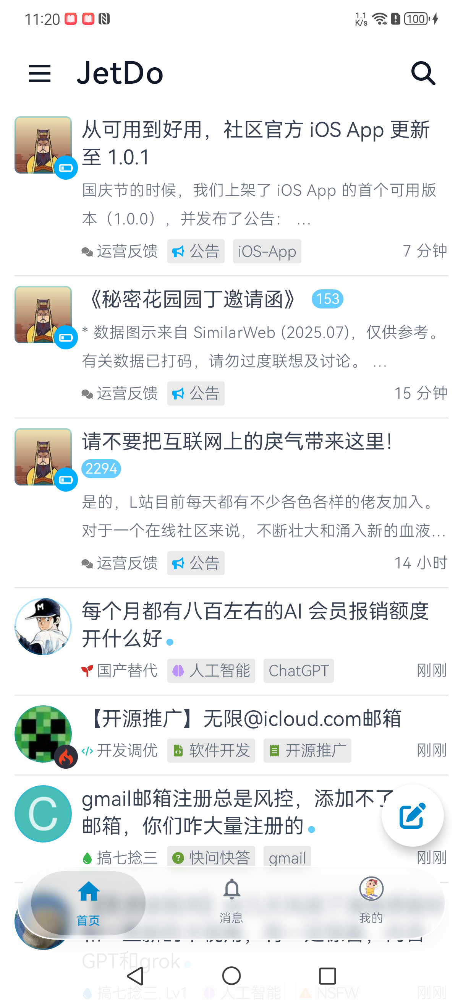
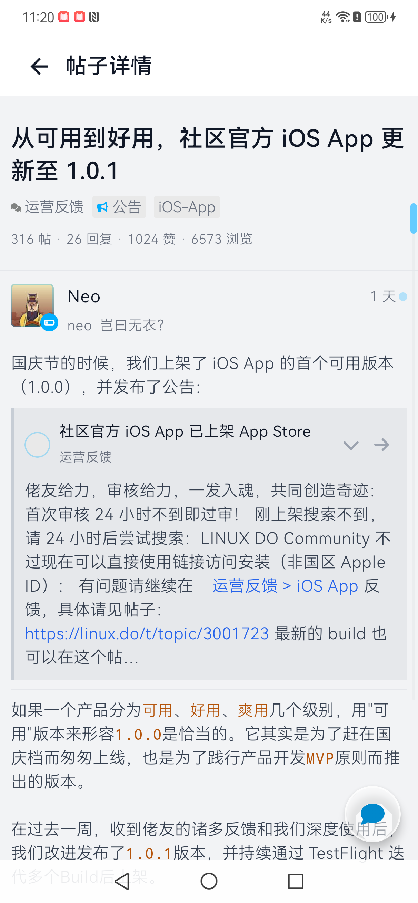
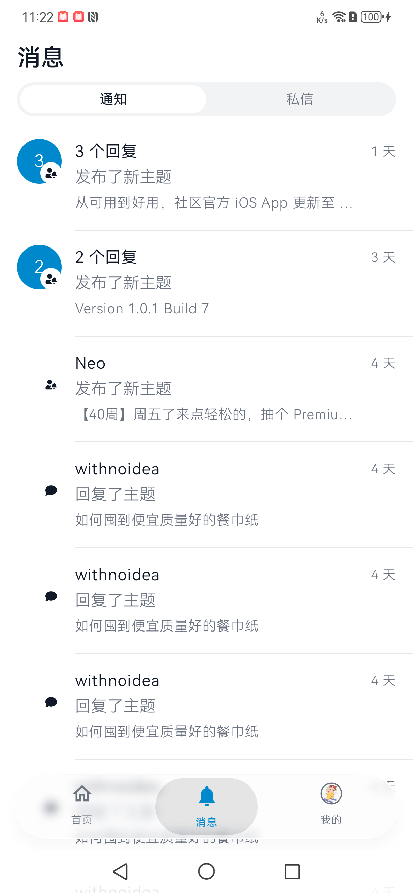
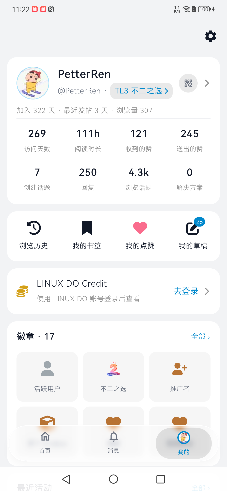
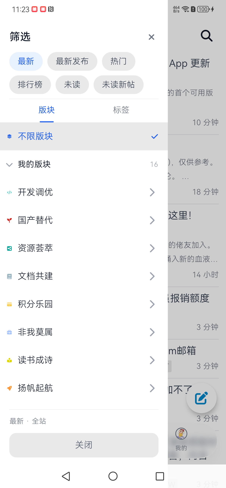
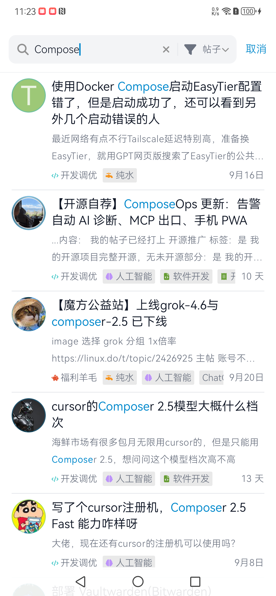
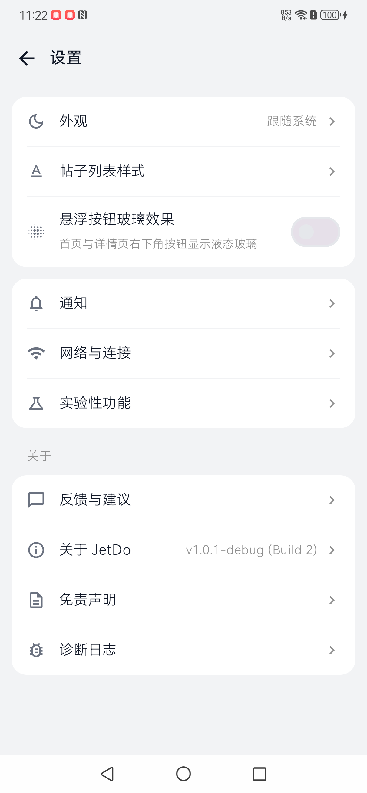
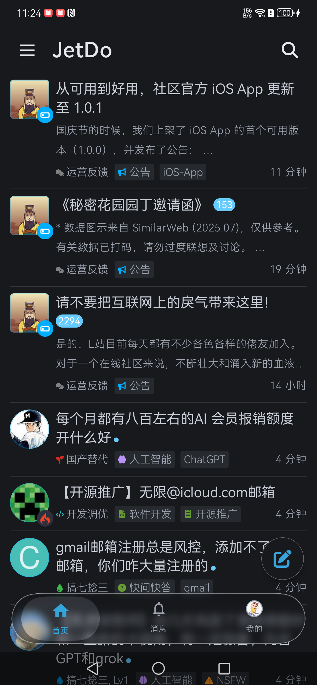
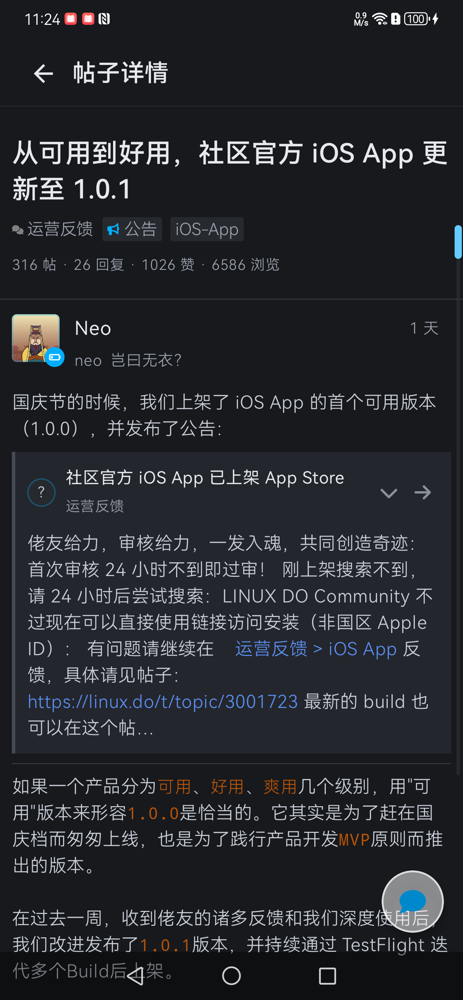

# JetDo

> 一个真诚、友善、团结、专业的 [LINUX DO](https://linux.do) 第三方 Android 原生客户端

[](https://developer.android.com/)
[](https://kotlinlang.org/)
[](https://developer.android.com/jetpack/compose)
[](https://linux.do)

JetDo 是为 [LINUX DO](https://linux.do) 社区打造的 Android 原生客户端，基于 Jetpack Compose 从零编写。没有跨平台框架，没有妥协的渲染层——帖子里的一切都渲染成真正的原生视图。

## 下载

<a href="https://github.com/xiaoxing1992/JetDo-Android/releases/latest"></a>

## 应用预览

| | | |
|---|---|---|
|  |  |  |
| **首页** | **话题详情** | **消息（通知 / 私信）** |
|  |  |  |
| **个人主页** | **筛选抽屉** | **搜索** |
|  |  |  |
| **设置** | **深色模式** | **深色阅读** |

## 功能特性

### 浏览

- 最新 / 热门 / 未读 / 新主题多入口，可在设置里勾选启用与排序
- 两级版块树抽屉，按分类看帖
- 话题详情窗口式分页加载，楼层快速跳转
- 引用卡与被引用楼层按需展开、跨帖跳转
- 采纳答案面板、话题摘要卡、按帖子 ID 直跳

### 互动

- 回复评论（Material3 Bottom Sheet）
- 表情回应、Boost 助力、投票、"俺也一样"
- 书签增删与置顶，列表 / 详情 / 导航栏三处标记即时联动

### 账号

- 站内 WebView 表单登录、扫码登录（扫入 / 出示两端）、站点授权登录（User API Key，App 内完成）
- 会话持久化，未登录写操作自动引导登录
- 个人主页、用户动态（我的话题 / 回复 / 点赞）、徽章墙
- 等级进度（读取 connect.linux.do 的升级要求）
- 通知中心与角标，覆盖 30+ 种通知类型（含 Boost、Follow）

### 阅读体验

- Discourse 阅读进度跟踪，蓝点淡出、"上次访问"红线
- Cooked HTML 自研解析器 → Compose 原生渲染
- LaTeX 数学公式渲染（MathJax）
- 图片预览（双击缩放、下拉关闭）、音视频播放、附件下载
- 站内 Emoji、FontAwesome 徽章图标、标签图标完整还原

### 适配

- Material3 主题（蓝灰配色）
- 三态深色模式：跟随系统 / 强制浅色 / 强制深色（资源级 values-night 兜底）
- 平板 / 折叠屏横屏双栏、竖屏单栏、桌面姿态自适应
- DoH 自定义 DNS（内置优选服务器，支持增删、切换、测速）

### 系统推送（开发中，需自建中继，见 `server/`）

- 计划支持 App 关闭时接收回复 / @ / 私信的系统通知，点击直达对应楼层
- 当前版本请以 App 内通知中心为准

## 技术实现

### WebView 网络桥

LINUX DO 有 Cloudflare 防护，原生 HTTP 栈发的请求会被拦。使用常驻隐藏 WebView 承载会话，所有接口请求都注入 JS 用浏览器侧的 `fetch` 发出，Cookie（`_t` / `cf_clearance`）由 WebView 自己管，JSON 回传给 Compose 渲染成原生界面。

> 核心文件：`app/src/main/kotlin/com/jetdo/android/services/network/ArkWebNetworkBridge.kt`

### Cloudflare 挑战的静默恢复

遇到挑战时先在后台重载宿主页，让挑战脚本自己跑通，每 2 秒用 `/latest.json` 探测是否放行；~12 秒还不通才弹出可见页面让用户手动点一下。

> 核心文件：`app/src/main/kotlin/services/challenge/ChallengeRecoveryCoordinator.kt`

### DoH

应对 DNS 污染。通过 OkHttp 的 DNS-over-HTTPS 支持实现，内置优选服务器，也可自己加。

> 核心文件：`app/src/main/kotlin/services/network/DohManager.kt`

### 头像与静态图

头像与正文图片统一走 Coil 加载，配磁盘缓存；失效图床有 host 黑名单兜底——同一域名连续两张图网络层失败即拉黑不再重试，避免刷列表时反复撞死链。

> 核心文件：`app/src/main/kotlin/com/jetdo/android/services/network/BlockedImageHosts.kt`

### 数学公式

Discourse 的裸 LaTeX 交给离屏 WebView 跑 MathJax 出 SVG，转成 Bitmap 供 Compose 使用。

> 核心文件：`app/src/main/kotlin/services/content/MathRenderService.kt`

### 系统推送（开发中）

Discourse 的 Web Push 是标准协议（RFC 8291），把 `endpoint` 填成自建中继、密钥用中继生成的，LINUX DO 就会用我们的公钥加密并投递到我们的地址；中继解密后转成 Firebase Cloud Messaging 通知下发。投递链路尚未迁移完成，当前版本以 App 内通知中心为准。

```
LINUX DO ──Web Push（加密）──▶ 自建中继 ──解密──▶ FCM ──▶ 设备通知
```

中继代码与部署文档在 `server/`。

## 构建

**环境要求**

- Android Studio Ladybug | 2024.2.1+
- JDK 17+
- Android SDK 37（compileSdk / targetSdk 37）
- 最低支持 Android 8.0 (API 26)

**步骤**

1. 克隆仓库后用 Android Studio 打开
2. 在 `local.properties` 配置签名信息
3. 连接设备或启动模拟器，Run

命令行构建：

```bash
./gradlew assembleDebug
```

## 项目结构

```
app/                 页面（ui/）、服务实现（services/）、导航、DI 组装
core/
├── model/           数据模型与纯逻辑（RelativeTime 等）
├── network/         网络契约
├── data/            Repository 层（会话 / 读态 / 通知等共享数据源）
└── designsystem/    主题、通用组件（TopicRow / UserAvatar / FaIcon 等）
feature/
├── home/            首页垂直切片（ViewModel + Route）
├── search/          搜索垂直切片
└── notification/    通知垂直切片

server/              推送中继（Python，部署在自己的服务器上）
├── relay.py         Web Push 解密 → FCM 转发
└── README.md        部署文档
```

## 技术栈

- **语言 / UI**：Kotlin + Jetpack Compose (Material3)
- **架构**：MVVM + 垂直切片（feature/），Hilt 依赖注入
- **异步**：Kotlin Coroutines & Flow
- **网络**：WebView 网络桥 + OkHttp（DoH）+ Ktor Client（备用）
- **数据**：Room + DataStore
- **图片**：Coil（磁盘缓存 + SVG）
- **推送**：Firebase Cloud Messaging

## 常见问题

**打开一直转圈 / 提示网络异常？**
多半是 DNS 被污染。进「设置 → 网络与连接 → DoH 设置」开启 DoH 并切换服务器。

**卡在人机验证？**
正常情况下 App 会在后台静默过盾。若首页空白超过几秒，会浮现「手动验证」按钮，点进去完成验证即可。

**能发新帖吗？**
能。支持发新主题与回复，正文支持上传图片（相册选图 / 拍照）、视频（上传前自动转码）。私信走内嵌网页。

## 关于 LINUX DO

[LINUX DO](https://linux.do) 是一个真诚、友善、团结、专业的技术社区，汇聚了众多热爱技术、乐于分享的开发者。JetDo 作为第三方客户端，致力于为 Android 用户提供流畅的原生浏览体验。

**注意**：本项目为非官方客户端，与 LINUX DO 官方无直接关联。

## 问题反馈

如果你在使用过程中遇到问题或有建议，欢迎：

- 在 [LINUX DO](https://linux.do) 论坛发帖讨论
- 提交 [Issue](https://github.com/xiaoxing1992/JetDo-Android/issues)

## 免责声明

JetDo 是个人开发的第三方客户端，与 LINUX DO 官方无关，不代表社区立场。所有内容版权归 LINUX DO 社区及原作者所有。本项目仅供学习交流，请遵守 [LINUX DO](https://linux.do) 社区规则。

## 开源协议

[MIT License](https://opensource.org/licenses/MIT)

---

Made with ❤️ for **[LINUX DO](https://linux.do)**
